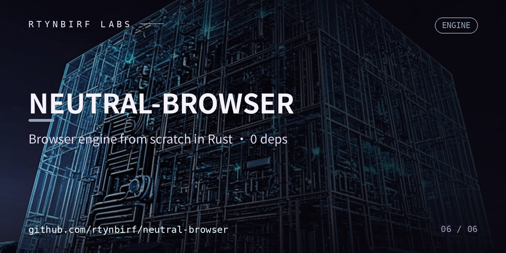

# Neutral Browser — НЕЙТРАЛЬНЫЙ БРАУЗЕР ПОЛЬЗОВАТЕЛЯ

<p align="center"></p>


Инструмент пользователя: `USER → BROWSER → WEB`. Без обязательного корпоративного
посредника, аккаунта, облака, телеметрии и рекламы. Спецификация — МАСТЕР-ПРОМПТ
(`docs/MASTER_PROMPT.md`). Правило проекта: **каждый статус подтверждается машинным
выводом, а не обещанием**.

Текущая версия: **0.11.0 / STAGE10_VARS**

## Фундамент: ЧЕЛОВЕК ПРЕВЫШЕ ВСЕГО

Цвет, шрифт, оформление — для человека, созданы человеком, а не людьми; забота
о его зрении и когнитивном здоровье — требование к фундаменту, а не украшение.
Контракт заморожен в `docs/HUMAN_FIRST.md`: приватность и автономность встроены
построением (брокер, ноль зависимостей, офлайн-first), нормы здоровья
(WCAG 2.2 контраст, ≤3 Гц вспышки, межстрочный ≥1.5, строка 50–75, тач-цели
≥44 px) вводятся ТОГДА ЖЕ, когда вводится механизм, который может их нарушить.

Этап 9 выполняет это обещание буквально: текст в движке — значит нормы текста
измеряются движком. Страт по умолчанию 16px × 1.5 = 24px (`LH_DEFAULT`), длина
строки против 75 знаков (`MEASURE_MAX_CHARS`), контраст каждой пары
текст/эффективный-фон против WCAG 2.2 AA (4.5:1) и APCA Lc 75
(`WCAG_FLOOR_X100`, `APCA_FLOOR_X100`) — имена заморожены, гейт следит за
именем и значением. Страница-нарушитель честно получает свои
`HEALTH_*_VIOLATIONS`, а не молчаливое «норм».

Цепочка этапа 9: `URL → Broker → TCP → HTTP/1.1 → тело → HTML → DOM → CSS → STYLE → LAYOUT (боксы + строковые боксы) → DISPLAY LIST (заливки + глифы) → PAINT (бинарный PPM и PNG) → машинный отчёт + HEALTH-счётчики`

## Что уже РАБОТАЕТ (VERIFIED — машинное доказательство)

| Компонент | Статус | Доказательство |
|---|---|---|
| Capability-модель `Policy → Broker → Decision` (этап 1) | VERIFIED | `SELF_TEST=PASS`, `WEB_TO_OS=DENY`, `WEB_NETWORK=ALLOW`, `NON_WEB_NETWORK=DENY` |
| Реальная сборка Rust, ноль внешних зависимостей | VERIFIED | `cargo build` SUCCESS; `Cargo.lock` зафиксирован; `[dependencies]` пуст (проверяет `tests/architecture.py`) |
| URL-парсер (подмножество: http, IPv4/IPv6, порт, путь, query) | VERIFIED | `URL_PARSE=PASS` |
| Разбор HTTP/1.1-ответа (статус, заголовки) | VERIFIED | `HTTP_PARSE=PASS` |
| Chunked-декодер (RFC 9112) | VERIFIED | `CHUNKED_DECODE=PASS` + `E2E_T2_SHA` |
| SHA-256 (FIPS 180-4, целостность тела) | VERIFIED | `SHA256_VECTORS=PASS` (3 опубликованных вектора NIST) |
| Fetch-цепочка целиком через брокер | VERIFIED | `E2E_TEST=PASS` — 36 случаев (T1–T29, 273 проверки) на живом локальном сервере |
| Стресс-эталон GOLOGRAMMA v1: автономный реальный файл 406 КБ (718 элементов, глубина DOM 17, один `<style>` на 322 КБ: @media/@keyframes/@font-face, var()-переменные, flex/grid) проходит `--dom-file`→STYLE→LAYOUT→PAINT→PNG без падений; счётчики этапа 9 (252 правила, 31 at-правило пропущено, 38 ошибок стилей, 675 боксов, 477 строк, 20 922 знака, 3264 глифовых команды, 3 отсутствующих глифа, канва #ffffff, HEALTH: 61/50/7/7 нарушений) и sha256 PNG заморожены как база; файл-эталон в `tests/fixtures/gologramma_v1.html` | VERIFIED | `E2E_T27_*` (27 проверок, fixture sha256 + замороженный sha256 PNG) |
| Путь отказа брокера (сокет не открывается) | VERIFIED | `E2E_T4_DENIED`, `NETWORK=CLOSED` |
| Структурный инвариант: единственный `TcpStream::connect` в `src/network.rs`, за брокером | VERIFIED | `STAGE2_STRUCTURE=PASS` |
| HTML-токенизатор (подмножество WHATWG §13.5): данные, теги, семейство атрибутов, комментарии (включая `--!>`), фиктивный комментарий, DOCTYPE (имя), RAWTEXT/RCDATA/PLAINTEXT, символьные ссылки | VERIFIED | `HTML_TOKENIZER=PASS` (самотест) + 101 юнит-тест `cargo test` |
| Числовые символьные ссылки с нормативной таблицей windows-1252 (0x80–0x9F) и правилами U+FFFD | VERIFIED | юнит-тесты: `&#128;`→€, `&#xD800;`→FFFD, `&#0;`→FFFD |
| Конструктор дерева DOM (подмножество WHATWG §13.2.6): подразумеваемые html/head/body, void-элементы, автозакрытие p/li/dd/dt, `</br>`→`<br>`, `image`→`img`, пропуск LF после pre/textarea/listing | VERIFIED | `DOM_TREE=PASS` (самотест) + юнит-тесты с точным дампом дерева |
| Канонический дамп дерева DOM (замороженный формат, итеративный) | VERIFIED | `E2E_T9_DUMP_EXACT` — побайтовое равенство на хитром документе |
| Вложенность 10 000 элементов без переполнения стека | VERIFIED | юнит-тесты; дамп/подсчёты/каскад — итеративные алгоритмы |
| Восстановление после ошибок разбора HTML без паники | VERIFIED | `PARSE_ERRORS=N` + `PARSE_ERROR_KINDS` (до 8 kinds) |
| CSS-токенизатор (подмножество CSS Syntax L3): ident/function/at-keyword/hash/string/bad-string/url/bad-url/number/percentage/dimension/delim/пунктуация, `\`-escape (hex до 6 цифр + нормативные U+FFFD-правила) | VERIFIED | `CSS_TOKENIZER=PASS` (самотест) + юнит-тесты токенизатора |
| CSS-парсер: qualified-правила, декларации с `!important` (включая `! important`), восстановление после ошибок без паники (пустое значение, мусор, вложенное правило, EOF в блоке, лишняя `}`), at-правила поглощаются и считаются | VERIFIED | `CSS_PARSE=PASS` + юнит-тесты восстановления |
| Селекторы (подмножество Selectors L3): тип, `*`, `.class` (чувствителен к регистру), `#id`, `[attr]`, `[attr="value"]` (точное), комбинаторы потомок/`>`, группировка через запятую; специфичность (a,b,c) | VERIFIED | `CSS_CASCADE=PASS` + юнит-тесты (специфичность `div p.x#a [b]` = (1,2,2)) |
| Каскад (author origin): победитель = max(important, inline, специфичность, порядок источника); инлайн-стиль бьёт обычные правила листа, `!important` листа бьёт инлайн | VERIFIED | `CSS_CASCADE=PASS` + `E2E_T11_DUMP_EXACT` (страница с 6 правилами, инлайном и `!important`) |
| Matching по DOM: class-список по пробелам, точное `[attr=value]`, право-в-лево по комбинаторам | VERIFIED | юнит-тесты `matching_descendant_child_class_split` |
| Канонический STYLE-дамп (замороженный формат `STYLE v2`: собственные свойства, затем `~имя: значение` для унаследованных; всё по алфавиту) | VERIFIED | `E2E_T11_DUMP_EXACT`, `E2E_T13_DUMP_EXACT`, `E2E_T14_DUMP_EXACT` — побайтовое равенство |
| Источники CSS: `<style>`-элементы DOM + `<link rel=stylesheet>` (скачиваются той же fetch-цепочкой через брокер, дедупликация по URL, лимит 8, ошибки считаются) + файл пользователя `--css-file` (юзер-принципипал) | VERIFIED | `E2E_T15` (link+style), `E2E_T17` (три вида отказов ссылок не прерывают каскад), `E2E_T19` (лимит), `E2E_T13` (--css-file) |
| Разрешение href ссылок (подмножество RFC 3986 §5): абсолютный/scheme-relative/абсолютный путь/относительный со снятием dot-сегментов, query-only, фрагмент отбрасывается | VERIFIED | `URL_RESOLVE=PASS` (самотест, 11 случаев) + `E2E_T18_URLS` |
| Наследование CSS (подмножество: 28 inherited-свойств, замороженный список в `css.rs`): вычисленное значение родителя распространяется вниз; перекрывается собственным каскадным победителем; initial values НЕ выдумываются | VERIFIED | `CSS_INHERIT=PASS` + `E2E_T14_DUMP_EXACT` + юнит-тесты (перекрытие в середине цепочки, не-наследование margin, цепь глубиной 500 без переполнения) |
| Блочная раскладка (подмножество CSS 2.1 гл. 10): поток блоков внутри content-box родителя, ICB 800×600; ширина §10.3.3 — px/%/auto, автополя центрируют, over-constrained решается в LTR (margin-right поглощает), width:auto обнуляет автополя; высота §10.6.3/§10.5 — px/% (только против definite-высоты контейнера), auto = сумма margin-box детей; padding/border-width в px/% (проценты — от ШИРИНЫ контейнера, включая вертикальные); `box-sizing: border-box`; `display: none` убирает поддерево | VERIFIED | `LAYOUT_RESOLVE=PASS`, `LAYOUT_FLOW=PASS` (самотест) + 20 юнит-тестов `layout.rs` (центрирование, over-constrained, border-box, стек высот, % высоты definite/indefinite, скрытые поддеревья, инвариант уравнений бокса) |
| Канонический LAYOUT-дамп (замороженный формат `LAYOUT v1`: `B<инд> <путь>` + `rect x y w h` / `margin` / `padding` / `border` / `content w h`, порядок документа, display:none-поддеревья отсутствуют) | VERIFIED | `E2E_T20_DUMP_EXACT`, `E2E_T21_SAME_DUMP` (chunked), `E2E_T22_DUMP_EXACT` — побайтовое равенство |
| Счётчики раскладки: `LAYOUT_BOXES`, `LAYOUT_HIDDEN` (элементы, чей собственный `display:none` убрал бокс), `LAYOUT_ERRORS` (неподдержанные значения известных свойств — учитываются и откатываются к умолчанию, работа не прерывается) | VERIFIED | `E2E_T20`, `E2E_T22_ERRORS` (width:red, display:flex → 2 ошибки, раскладка завершена) |
| Глубина 10 000 вложенных div в раскладке без переполнения стека | VERIFIED | юнит-тест `deep_nesting_10000_no_overflow` (все проходы раскладки итеративные) |
| Чистота модулей движка: `html.rs`/`dom.rs`/`css.rs`/`layout.rs`/`paint.rs`/`png.rs` без сетевого и файлового I/O | VERIFIED | `STAGE3/4/6/7/8_STRUCTURE=PASS` (`tests/architecture.py`) |
| Разбор цветов (подмножество CSS Color 3): `#rgb`/`#rrggbb`, `rgb()`/`rgba()` числами 0–255 и процентами (3 или 4 компонента), 16 базовых именованных CSS 2.1, `transparent`; альфа компонуется `over` на пиксель (детерминированная целочисленная математика, округление вверх на 0.5) | VERIFIED | `PAINT_COLORS=PASS` (самотест) + юнит-тесты `paint.rs` (clamp 300→255, 50%→128, 0.5→128, мусор → None) |
| Канва и пропагация фона (CSS 2.1 §14.2-подмножество): фиксированная канва VIEWPORT_W×VIEWPORT_H; валидный `background-color` у `html` красит всю канву (у html собственной заливки нет), иначе — у `body`; иначе белая канва; мусорное значение считается ошибкой ровно один раз | VERIFIED | `PAINT_FLOW=PASS` + юнит-тесты пропагации (html/body/ни одного/невалидный/display:none) |
| DISPLAY LIST + PAINT: заливка фона по border-box бокса, затем solid-бордеры — 4 неперекрывающиеся полосы longhand `border-*-width/style/color` (прочие стили = ошибка, откат к none); цвет бордера: `border-X-color` → `color` → чёрный; порядок документа, поздние команды поверх ранних; клиппинг в растре (дамп показывает идеальную геометрию); alpha 0 не порождает команды | VERIFIED | `PAINT_FLOW=PASS` + юнит-тесты (бордеры, перекрытие, клиппинг, откат dashed) + `E2E_T23` (пиксельные пробы всех 4 полос и бленда) |
| Канонический PAINT-дамп (замороженный формат `PAINT v1`: `CANVAS <hex>` + `F x y w h <hex>` в порядке рисования; цвет `#rrggbb` при a=255, иначе `#rrggbbaa`) и бинарный вывод PPM P6 (детерминированный, без сжатия) | VERIFIED | `E2E_T23_DUMP_EXACT`, `E2E_T23_PPM_SHA` (замороженный sha256), `E2E_T24_SAME_PPM` (chunked → те же байты) |
| Глубина 10 000 вложенных div в построении display list и растре без переполнения стека | VERIFIED | юнит-тест `deep_nesting_10000_paint_no_overflow` (все проходы итеративные) |
| Встроенный битмап-шрифт (`src/font_data.rs`, СГЕНЕРИРОВАН `scripts/gen_bitmap_font.py`): DejaVu Sans Mono 16px, 194 глифа (ASCII + кириллица + «»·–—…№✓☕✦δη и др.), серый AA, бинарный поиск по кодпоинту; данные — статические массивы, ноль аллокаций; отсутствие глифа честно считается (`LAYOUT_MISSING_GLYPHS`), шифры не выдумываются; лицензия Bitstream Vera допускает встраивание | VERIFIED | юнит-тесты `paint.rs` (глиф 'r' на красном в (3,6) = чистый чёрный, 'f' на белой рамке в (8,106)); `STAGE9_STRUCTURE=PASS` (GENERATED-заголовок + data-only инвариант) |
| Строковая раскладка (анонимные `::lines`-боксы, LAYOUT v2): текстовые узлы дробятся на слова, перенос по разделителям, `<br>` — принудительный разрыв (струт), базлайны по максимальному шрифту строки; дамп несёт `LN y h n w` и `WORD dx w текст`; высота строки: px, %, безразмерный множитель, дефолт 1.5 (`LH_DEFAULT`); пустой блок с текстом теперь имеет высоту строки | VERIFIED | `E2E_T20/T21/T22_DUMP_EXACT` (пере-заморожены на LAYOUT v2 с обоснованием каждого сдвига), `E2E_T28_*` (перенос в 120px, `<br>`, струты, кегль 32px) |
| HUMAN_FIRST-нормы измеряются движком на каждой строке и каждой паре текст/фон: межстрочный < 1.5 кегля → `HEALTH_LINE_HEIGHT_VIOLATIONS`; строка > 75 знаков → `HEALTH_LINE_LENGTH_VIOLATIONS`; контраст против WCAG 2.2 AA (4.5:1) и APCA 0.1.9 Lc 75 — константы `LH_DEFAULT=1.5`, `MEASURE_MAX_CHARS=75`, `WCAG_FLOOR_X100=450`, `APCA_FLOOR_X100=7500` заморожены ИМЯ+ЗНАЧЕНИЕ гейтом | VERIFIED | `E2E_T28_HEALTH_*` (страница-нарушитель: 5 тесных строк, 3 бледные пары), `E2E_T27_HEALTH_*` (реальная ГОЛОГРАММА: 61/50/7/7), `STAGE9_STRUCTURE=PASS` |
| Контраст по WCAG 2.2 (отношение ×100 против эффективного фона: канва + все заливки под точкой, компоновка `over` в порядке рисования) и по APCA 0.1.9 (Lc ×100, обе полярности: чёрный на белом 10604, белый на чёрном 10788); минимумы в дампе каждой текстовой команды | VERIFIED | юнит-тест `apca_both_polarities_positive` (регрессионный якорь бага WoB-ветки, находившего Lc 0 для всего светлого-на-тёмном) + `E2E_T28_WCAG_MIN/APCA_MIN` |
| Текст в PAINT (PAINT v2): команда `T x y цвет-текста цвет-фона wcag apca слово` после заливок владельца; глифы рисуются по битовым картам со сглаживанием, клиппинг канвой; детерминировано байт-в-байт | VERIFIED | `E2E_T23_DUMP_EXACT`/`E2E_T23_PPM_SHA` (пере-заморожены с T-командами) + `E2E_T28_PNG_SHA` (замороженный sha256 PNG с текстом) |
| CRC-32 (ISO 3309 / ITU-T V.42 — чексуммы чанков PNG) | VERIFIED | `PNG_CRC=PASS` (самотест): опубликованные вектора `"123456789"` → `0xCBF43926`, `"IEND"` → `0xAE426082` + юнит-тесты |
| Adler-32 (RFC 1950 §8.2 — контрольная сумма zlib-потока) | VERIFIED | `PNG_ADLER=PASS` (самотест): опубликованные вектора `"abc"` → `0x024D0127`, `"Wikipedia"` → `0x11E60398` |
| zlib-поток из STORED-блоков deflate (RFC 1950 + RFC 1951 §3.2.4): заголовок `78 01`, байто-выровненные блоки LEN/NLEN по 65535 байт, big-endian adler-трейлер | VERIFIED | `PNG_FLOW=PASS` + замороженные байты + многоблочный roundtrip (70 000 байт → 2 блока) + НЕЗАВИСИМЫЙ декодер: Python stdlib zlib надувает IDAT реального бинарника, скан-линии совпадают с PPM-эталоном |
| PNG-энкодер (ISO/IEC 15948): 8-бит RGBA (color type 6), filter 0 на каждой скан-линии, без interlace, IHDR+IDAT+IEND; побайтно детерминированный; честный отказ на неверной геометрии/длине буфера | VERIFIED | `PNG_FLOW=PASS` + замороженные байты 2×1 и длина 1 920 813 для 800×600 + `E2E_T26_PNG_SHA` (замороженный sha256), `E2E_T26_CHUNK_SEQ/CRC/IHDR`, 9 RGBA-проб, T26b (chunked → те же байты) |
| Устойчивость к реальному контенту: автономная страница-эталон (шрифты/стили/скрипты внутри файла) не валит движок на всей цепочке; неподдержанное (at-правила, flex/grid, позиционирование) учитывается в честных счётчиках, а не игнорируется молча | VERIFIED | `E2E_T27_*` — см. строку стресс-эталона выше |
| var() + custom properties (этап 10): декларации `--имя` сохраняют регистр (CSS: имена custom-свойств чувствительны к регистру, обычные — фолд в lowercase); custom-свойства наследуются ВЫЧИСЛЕННЫМ значением (дети видят результат подстановки, не сырой текст); `var(--имя)` / `var(--имя, fallback)` — подстановка на элементе против окружения (родительские вычисленные vars + собственные разрешённые); не-разрешённая ссылка без fallback — декларация отбрасывается на computed-value time (inherited-свойство честно откатывается к значению родителя); цепочки `--b: var(--a)` разрешаются фикспойнтом в том же проходе; циклы ссылок (--a↔--b, --a: var(--a)) делают оба свойства невалидными и считаются (`STYLE_VAR_CYCLES`); `var(bare)` без `--` — невалидно; `foovar(`/`-var(` не являются var()-вызовами; глубина подстановки ограничена `MAX_VAR_DEPTH=32` (детерминизм, дальше — unresolved, без паник) | VERIFIED | 12 юнит-тестов `css.rs` (базовая подстановка+наследование, регистр, fallback, отброс+откат к родителю, циклы, цепочка, вложенный fallback, многотокенное значение, плохое имя, foovar, инлайн-стиль) + `E2E_T29_*` (16 проверок: 3 vars, 9 refs, 1 fallback, 3 unresolved, 2 cycles, sha256 PNG) |
| Честные счётчики var() на любом входе: `STYLE_VARS_DEFINED` (свои custom-свойства, вычислившиеся OK), `STYLE_VAR_REFS` (var()-вызовы, встреченные подстановкой), `STYLE_VAR_FALLBACK_USED` (сработавшие fallback-ветки), `STYLE_VAR_UNRESOLVED` (ссылки без значения и без рабочего fallback), `STYLE_VAR_CYCLES` (свойства, убитые циклом) | VERIFIED | `E2E_T29_*` + пере-замороженный `E2E_T27_VAR_UNRESOLVED=541`: реальная ГОЛОГРАММА ссылается на var() 541 раз, не определив НИ ОДНОГО custom-свойства — страница честно признаётся в этом в счётчиках; INHERITED 2159→1815 — та же честная коррекция (сырой var()-текст больше не течёт по дереву как «наследованное значение») |

## Что НЕ реализовано (честно, анти-фасад из МАСТЕР-ПРОМПТА §23)

| Компонент | Статус |
|---|---|
| HTTPS/TLS | NOT_IMPLEMENTED (план: вендоренный rustls по `docs/DEPENDENCY_POLICY.md`) |
| HTTP/2, HTTP/3 (QUIC) | NOT_IMPLEMENTED |
| Редиректы (следование 3xx) | NOT_IMPLEMENTED — статус только отображается |
| Настраиваемый DNS / DoH | NOT_IMPLEMENTED — используется системный резолвер ОС |
| Проверка scope в Policy | NOT_IMPLEMENTED — scope записывается в capability, политикой пока не проверяется |
| at-правила CSS (at-rules: `@media`, `@import`, `@font-face`…) | NOT_IMPLEMENTED — поглощаются без применения, счётчик `STYLE_AT_RULES_SKIPPED`; @import не скачивается |
| Ключевые слова `inherit`/`initial`/`unset`/`revert` | NOT_IMPLEMENTED — значения хранятся как дословный текст |
| var() внутри строк-токенов и регистрозависимые не-ASCII хитрости имён | NOT_IMPLEMENTED — подстановка этапа 10 заменяет var() во всём значении без анализа строковых позиций (движок не рисует `content`, поэтому подмена внутри строки на практике не возникает; задокументированное подмножество) |
| Начальные значения (initial values) свойств | NOT_IMPLEMENTED — унаследованное свойство без значения у предков остаётся отсутствующим (честное отсутствие, не выдуманная таблица умолчаний) |
| Атрибуты `media`/`disabled` у `<link>` и `<style>` | NOT_IMPLEMENTED — все собранные листы применяются безусловно |
| Следование @import внутри скачанных листов | NOT_IMPLEMENTED — at-правила поглощаются, глубина скачивания = 1 (только ссылки из HTML) |
| Продвинутые селекторы: псевдоклассы/псевдоэлементы, `+`/`~`, атрибутные операторы `~= ^= $= *= \|=`, пространства имён | NOT_IMPLEMENTED — такой селектор = ошибка разбора, правило отбрасывается (счётчик `STYLE_ERRORS`) |
| Строчная раскладка за пределами базового потока (inline-элементы `span`/`a`/`em` как отдельные боксы, inline-block, вертикальные выравнивания baseline-семейства) | NOT_IMPLEMENTED — все текстовые узлы строки делят одну анонимную строку, стили текста берутся от блочного владельца |
| Рисование изображений, градиентов, box-shadow, outline, border-radius, background-image/repeat/position, opacity, трансформации; кеглевые размеры глифов не масштабируются к hinting ОС | NOT_IMPLEMENTED — paint рисует сплошные заливки, solid-бордеры и глифы встроенного битмап-шрифта |
| Стили бордера кроме `solid` (dashed/dotted/double/…) | NOT_IMPLEMENTED — такая декларация считается ошибкой `PAINT_ERRORS` и откатывается к `none` |
| `currentcolor` как явное значение, hex-альфа `#rgba`/`#rrggbbaa`, пробельный синтаксис `rgb(1 2 3)` | NOT_IMPLEMENTED — такие значения = ошибка; цвет бордера без `border-X-color` берётся из `color`, иначе чёрный (аппроксимация initial currentcolor — задокументированное отклонение) |
| JPEG/WebP вывод изображения | NOT_IMPLEMENTED — бинарный PNG (этап 8, собственный zlib-stored энкодер) и PPM P6 реализованы; JPEG требует DCT и выходит за подмножество |
| Inline-элементы как inline | NOT_IMPLEMENTED — раскладываются как блоки (отклонение задокументировано в `layout.rs`); block-in-inline сплиттинга нет |
| Таблица стилей агента пользователя (UA stylesheet) | NOT_IMPLEMENTED — замороженные подмножества: списки inline-by-default и never-rendered элементов в `layout.rs`; умолчания margin/padding = 0 |
| Float / position / flex / grid / table-layout / min-max размеры / трансформации | NOT_IMPLEMENTED — раскладывается только статический блок-поток |
| Схлопывание вертикальных margin (margin collapsing) | NOT_IMPLEMENTED — вертикальные отступы просто складываются |
| Shorthand `border` в раскладке | NOT_IMPLEMENTED — читаются только longhand `border-*-width`/`border-width`; сам shorthand игнорируется (как не-layout свойство) |
| Конфликт shorthand/longhand (`margin` vs `margin-left`) | NOT_IMPLEMENTED по исходному порядку — longhand всегда побеждает (порядок алфавита дампа STYLE, задокументированное упрощение) |
| Shorthand-раскрытие, `var()`, CSS-переменные, @keyframes | NOT_IMPLEMENTED — значения хранятся как текст |
| Foster parenting и режимы вставки таблиц | NOT_IMPLEMENTED — `<table><tr>` парсится без подразумеваемого `<tbody>` (документированное отклонение) |
| Алгоритм усыновления (adoption agency) и активные форматирующие элементы | NOT_IMPLEMENTED — неправильно вложенные `b/i/em` остаются буквально вложенными |
| Иностранный контент (SVG/MathML) | NOT_IMPLEMENTED — `<svg>`/`<math>` парсятся как обычные HTML-элементы |
| Специальные режимы `<template>` | NOT_IMPLEMENTED |
| Полная таблица именованных символьных ссылок (2231 запись) и legacy-набор без `;` | NOT_IMPLEMENTED — реализовано 80 общих имён с обязательным `;` |
| public/system-идентификаторы DOCTYPE, вычисление quirks mode | NOT_IMPLEMENTED — захватывается только имя |
| Layout / рендеринг / JS | NOT_IMPLEMENTED частично: блочная раскладка (этап 6) и программный paint сплошными заливками (этап 7) есть; строчная раскладка, композитинг, GPU-путь и JS — этапы 8+ по МАСТЕР-ПРОМПТУ |
| Песочница ОС (seccomp/pledge/AppContainer) | NOT_IMPLEMENTED — этап 1 остаётся прототипом policy/broker в одном процессе |
| obs-fold в заголовках, gzip/br-сжатие | NOT_IMPLEMENTED — такие ответы отклоняются как BAD_HEADER |

## Запуск

Сборка (после установки Rust; нулевые внешние зависимости):

```text
cargo build --locked
```

Самотест (без сети, без серверов):

```text
./target/debug/neutral-browser --self-test
```

Ожидаемый вывод:

```text
SELF_TEST=PASS
WEB_TO_OS=DENY
WEB_NETWORK=ALLOW
NON_WEB_NETWORK=DENY
URL_PARSE=PASS
HTTP_PARSE=PASS
CHUNKED_DECODE=PASS
SHA256_VECTORS=PASS
HTML_TOKENIZER=PASS
DOM_TREE=PASS
CSS_TOKENIZER=PASS
CSS_PARSE=PASS
CSS_CASCADE=PASS
URL_RESOLVE=PASS
CSS_INHERIT=PASS
LAYOUT_RESOLVE=PASS
LAYOUT_FLOW=PASS
PAINT_COLORS=PASS
PAINT_FLOW=PASS
PNG_CRC=PASS
PNG_ADLER=PASS
PNG_FLOW=PASS
```

Структурные тесты и сквозной прогон (поднимает локальный тест-сервер и гоняет
реальный бинарник через 33 случая / 208 проверок):

```text
python3 tests/architecture.py
python3 tools/e2e.py
```

Юнит-тесты токенизаторов, дерева и каскада:

```text
cargo test
```

Загрузка страницы, разбор в DOM, каскад стилей, раскладка и отрисовка:

```text
./target/debug/neutral-browser --fetch http://127.0.0.1:18080/index.html --dom
./target/debug/neutral-browser --fetch <url> --dom --style --style-output <style.txt>
./target/debug/neutral-browser --fetch <url> --layout --layout-output <layout.txt>
./target/debug/neutral-browser --fetch <url> --paint --paint-output <page.ppm> --paint-dump <paint.txt>
./target/debug/neutral-browser --fetch <url> --paint --png-output <page.png>
./target/debug/neutral-browser --dom-file <page.html> --style --css-file <user.css> --style-output <style.txt>
./target/debug/neutral-browser --dom-file <page.html> --layout --css-file <user.css> --layout-output <layout.txt>
./target/debug/neutral-browser --dom-file <page.html> --paint --css-file <user.css> --png-output <page.png>
```

`--layout` подразумевает `--style`: каскад всегда выполняется перед раскладкой
(блок STYLE в отчёте печатается как при `--style`), затем идёт блок LAYOUT.

`--dom-file` и `--css-file` читают файлы, явно указанные пользователем в его
собственной командной строке: это действие самого пользователя над своими
файлами, а не возможность веб-контента (политика брокера этапа 1 не тронута —
веб-контент по-прежнему не имеет доступа к файловой системе).

Машинный отчёт DOM-блока: `DOM_NODES`, `DOM_ELEMENTS`, `DOM_TEXTS`,
`DOM_COMMENTS`, `DOM_DOCTYPE`, `DOM_DEPTH`, `PARSE_ERRORS`,
`PARSE_ERROR_KINDS`, `DOM_SAVED`, `DOM=OK`.

Машинный отчёт STYLE-блока: `STYLE_SRC_ELEMENTS` (число `<style>`-элементов),
`STYLE_LINK_SHEETS` (найдено `<link rel=stylesheet>`), построчные
`LINK_SHEET_FETCHED=<url>` / `LINK_SHEET_FAIL=<href>` + `LINK_SHEET_KIND=`
(`NO_BASE_URL`, `NO_HREF`, `BAD_URL`, `HTTP_<статус>`, `UNSUPPORTED_SCHEME`,
`DNS`, `CONNECT`, `IO`, `LIMIT`), `STYLE_LINK_SHEETS_FETCHED`,
`STYLE_LINK_SHEETS_FAILED`, `STYLE_LINK_DUPES` (дедупликация по разрешённому
URL), `STYLE_RULES`, `STYLE_DECLS` (выжившие декларации),
`STYLE_AT_RULES_SKIPPED`, `STYLE_ERRORS` (CSS-ошибки и отказавшие листы не
прерывают работу — восстановление нормативно; прерывают только ошибки I/O
файла), `STYLE_ELEMENTS_STYLED`, `STYLE_PROPS`, `STYLE_INHERITED` (число
унаследованных значений в дампе), `STYLE_INHERITED_ELEMENTS`, `STYLE_SAVED`,
`STYLE=OK`.

Коды выхода: `0` OK; `2` ошибка использования; `3` схема не поддерживается
(например `https` или `file://`); `4` отказ брокера; `5` сетевая/протокольная
ошибка либо ошибка I/O.

`--subject <s>` — диагностический флаг для проверки пути отказа
(пример: `--subject untrusted-process` → `BROKER_DECISION=DENY`). Это средство
тестирования уровня CLI: пользователь — хозяин; веб-контент таких прав не имеет.

## Инварианты этапов 2–5

1. Единственный `TcpStream::connect` в кодовой базе — в `src/network.rs`
   (машинно проверяется `tests/architecture.py`).
2. `html.rs`, `dom.rs`, `css.rs` — чистые модули: ноль сетевого и файлового I/O
   (машинно проверяется тем же скриптом).
3. Каждое соединение проходит `Policy → Broker`; запрашивающий не подсовывает
   своё решение (наследование этапа 1, не нарушено).
4. Capability (subject/resource/operation/scope/lifetime) выводится движком
   из URL, а не вводится извне.
5. Сеть трогается только командой пользователя `--fetch`: никаких фоновых
   соединений; телеметрии нет по построению — ей просто негде быть.
6. Host и path валидируются по белому списку печатного ASCII — CRLF-инъекция
   в запросную строку и заголовок Host невозможна (`BAD_HOST` / `BAD_PATH`).
7. Переключение RAWTEXT/RCDATA/PLAINTEXT выполняет конструктор дерева через
   `TokControl` — как в спецификации; самозакрывающийся `<script/>` не
   переключает токенизатор.
8. Каскадный порядок (author origin): inline important > sheet important >
   inline normal > sheet normal, внутри уровня — специфичность, затем порядок
   источника; свойства в дампе отсортированы по имени (детерминизм).
9. Имена CSS-свойств и типов селекторов ASCII-приводятся к нижнему регистру;
   имена классов, id и значения атрибутов регистрозависимы.
10. Движок ни при каком входе не паникует: токенизатор, парсер, matching,
    каскад и наследование — итеративные алгоритмы с восстановлением.
11. `<link rel=stylesheet>` скачивается ТОЙ ЖЕ цепочкой `network::fetch`
    через брокер (capability выводится движком из URL листа); скачивание
    разрешено только при `--fetch` (есть базовый URL); лимит 8 уникальных
    листов на страницу; дедупликация по разрешённому URL; отказ одного
    листа не прерывает каскад — считается и печатается своей машиной-строкой.
12. Наследование: замороженный список 28 inherited-свойств (`is_inherited` в
    `css.rs`); ребёнок получает вычисленное значение родителя, собственный
    каскадный победитель перекрывает; initial values отсутствуют;
    `rel="alternate stylesheet"` не применяется автоматически; порядок
    источников каскада — порядок документа по всем листам вместе.

## Изменения относительно stage9 (0.10.0)

- var() и custom properties (STAGE10_VARS). Что вошло: декларации `--имя`
  (регистр сохраняется — CSS-специфика custom-имён), наследование
  ВЫЧИСЛЕННОГО значения custom-свойства, подстановка `var(--имя)` и
  `var(--имя, fallback)` на элементе против окружения «родительские
  вычисленные vars + собственные разрешённые», фикспойнт-разрешение цепочек
  внутри элемента, детекция циклов ссылок (оба свойства невалидны,
  `STYLE_VAR_CYCLES`), отброс не-разрешённых деклараций на computed-value
  time (inherited-свойство откатывается к родительскому значению — как в
  CSS), глубина подстановки `MAX_VAR_DEPTH=32` без паник.
- Счётчики `STYLE_VARS_DEFINED / STYLE_VAR_REFS / STYLE_VAR_FALLBACK_USED /
  STYLE_VAR_UNRESOLVED / STYLE_VAR_CYCLES` — в отчёте и в живой странице.
- ГОЛОГРАММА пере-заморожена честно: она 541 раз ссылается на var(), не
  определив ни одного custom-свойства → `STYLE_VAR_UNRESOLVED=541`
  теперь видно в машинном отчёте; `STYLE_INHERITED` 2159→1815 — раньше
  сырой var()-текст попадал в наследуемые значения и раздувал счётчик
  мусором, который никто не мог нарисовать; теперь такие декларации
  отбрасываются, и счётчик показывает реальный поток значений.
- PNG GOLOGRAMMA побайтно тот же (0ada3621…): var()-значения и раньше не
  могли быть нарисованы — теперь это не «молчаливо», а видно в счётчиках.
- e2e: 36 случаев / 273 проверки (новый T29 — 16 проверок на
  vars_v1.html + `E2E_T27_VAR_UNRESOLVED`); гейт: фаза STAGE10_STRUCTURE
  (пины функций подстановки, счётчиков, MAX_VAR_DEPTH=32, условного
  фолда регистра); юнит-тесты 111→123.
- Исправлен косметический warning rustc 1.99 (лишние скобки в paint.rs) —
  снова 0 предупреждений.

## Изменения относительно stage8 (0.9.0)

- Новый модуль `src/font_data.rs` — СГЕНЕРИРОВАН `scripts/gen_bitmap_font.py`
  из DejaVuSansMono.ttf (растеризация freetype, 16 px, 256 уровней серого):
  194 глифа (ASCII, кириллица, «»·©–—…№←↑→↓✓☕✦δη…), бинарный поиск по cp,
  статические массивы без аллокаций. НЕ ПРАВИТЬ РУКАМИ — гейт требует
  GENERATED-заголовок и data-only инвариант. Лицензия — «Шрифт» ниже.
- `src/layout.rs`: строковая раскладка. Текстовые узлы дробятся на слова,
  слова собираются в анонимные строки (`::lines`-боксы в дампе `LAYOUT v2` с
  записями `LN`/`WORD`), перенос по разделителям, `<br>` — разрыв со струтом,
  высота строки по максимальному кеглю строки. Дефолтный страт — 16px × 1.5
  (`LH_DEFAULT`, норма HUMAN_FIRST, а не CSS `normal`). `LAYOUT_LINES`,
  `LAYOUT_TEXT_CHARS`, `LAYOUT_BREAKS`, `LAYOUT_MISSING_GLYPHS`,
  `LAYOUT_LINE_CHARS_MAX` — новые честные счётчики. Все проходы итеративные
  (глубина 10 000 не переполняется). `LH_DEFAULT`, `MEASURE_MAX_CHARS`,
  `FS_MAX` — pub-константы, пинятся гейтом по имени и значению.
- `src/paint.rs`: текст в PAINT. Команда `T x y fg bg wcag apca слово`;
  эффективный фон под глифом = канва + все заливки под точкой (`over` в
  порядке рисования); WCAG-отношение ×100 и APCA 0.1.9 Lc ×100 на каждую
  команду; минимумы `PAINT_WCAG_MIN_X100`/`PAINT_APCA_MIN_LC_X100`;
  нарушения `HEALTH_CONTRAST_VIOLATIONS`/`HEALTH_APCA_VIOLATIONS` против
  `WCAG_FLOOR_X100=450`/`APCA_FLOOR_X100=7500`. Исправлен баг WoB-ветки APCA
  (вычитание было перепутано — каждый светлый-на-тёмном текст получал Lc 0);
  регрессионный якорь — юнит-тест `apca_both_polarities_positive`.
- `src/main.rs`: `VERSION 0.10.0`, `STATUS=STAGE9_TEXT`, флаги не менялись
  (--layout/--paint/--png-output/--*-output); `#[allow(dead_code)]` на
  сгенерированном модуле шрифта (полная геометрия ячейки генератора, не вся
  потребляется стратом) — единственный не-генераторный хэнд-эдит.
- `tools/e2e.py`: **защита от протухшего бинарa** — пин `EXPECTED_VERSION`,
  без совпадения ни один случай не запускается (реальный инцидент: зелёная
  «228/228» против старого debug-бинар 0.9.0 в момент, когда дерево было уже
  0.10.0); кейс T28 (фикстура `tests/fixtures/text_v1.html`: перенос, струты,
  юникод, отсутствующий глиф, нарушения норм, замороженный sha256 PNG);
  T20–T27 пере-заморожены с обоснованием каждого сдвига (line boxes меняют
  геометрию, текст меняет PPM/PNG — это этап, а не регрессия); 35 случаев,
  247 проверок.
- `tests/architecture.py`: фаза `STAGE9_STRUCTURE` (font_data в whitelist
  модулей/чистоты/слоинга: layout→font_data, paint→font_data; токены шрифта,
  строк, контраста; HEALTH-токены; GENERATED-заголовок; data-only; пины
  LH_DEFAULT=1.5 / MEASURE_MAX_CHARS=75 / WCAG_FLOOR_X100=450 /
  APCA_FLOOR_X100=7500); README-фразы этапа 9; починены две испорченные
  строки `need()`/`who =` (дерево прошлого сеанса осталось посреди правки —
  гейт не запускался).
- `tools/manifest.py` + `MANIFEST.sha256`: артефакт-FREEZE (харвест из
  разбора ФУНДАМЕНТА.md — машинно-проверяемое ядро автора без его
  фундаментальной ошибки: никаких ClaimTime-полей; якорь = git-история +
  гейт, а не сам файл). append-only журнал: `freeze <tag> <файл>` —
  дописывает sha256, `verify` — сверяет ТЕКУЩИЕ байты каждого артефакта с
  последней записью (молчаливое изменение контрактного файла красит гейт,
  осознанное — пере-замораживается новым тегом на виду у git). Заморожено
  при этапe 9: обе фикстуры + 4 контрактных документа; фаза
  `MANIFEST_VERIFY=PASS` в гейте.
- README: база ГОЛОГРАММЫ пере-заморожена на этап 9 (675 боксов, 477 строк,
  3264 глифовых команды, HEALTH 61/50/7/7 — страница честно признаётся
  нарушителем норм; var() по-прежнему NOT_IMPLEMENTED).

## Шрифт

`src/font_data.rs` — растры глифов **DejaVu Sans Mono** (16 px на эм-квадрат,
полутоновое сглаживание). DejaVu — свободный шрифт на базе Bitstream Vera
(лицензия Bitstream Vera / DejaVu license): распространение, модификация и
встраивание разрешены, в т.ч. в бинарные артефакты; текст лицензии — в
репозитории исходника шрифта, имя шрифта сохранено в заголовке
сгенерированного файла. Шрифт встроен в бинарник — офлайн по построению,
ничего не скачивается.

## Изменения относительно stage7 (0.8.0)

- `src/png.rs` (новый, ~300 строк, чистый модуль — ноль I/O, ноль паник,
  итеративно): CRC-32 (таблица 256, полином 0xEDB88320, опубликованные
  вектора), Adler-32 (RFC 1950 §8.2), zlib-поток из STORED-блоков deflate
  (RFC 1950 + RFC 1951 §3.2.4: `78 01`, блоки LEN/NLEN по 65535 байт,
  big-endian adler-трейлер) и PNG-энкодер (ISO/IEC 15948: 8-бит RGBA,
  color type 6, filter 0, без interlace, IHDR+IDAT+IEND); `encode` возвращает
  Option и честно отклоняет неверную геометрию/длину буфера; +6 юнит-тестов
  (101 всего), включая тестовый stored-инфлятор для roundtrip-проверки
  собственных блоков.
- `src/main.rs`: `VERSION 0.9.0`, `STATUS=STAGE8_PNG`, цепочка продлена до
  `...->DISPLAY->PAINT->PNG`; `--png-output` (бинарный PNG поверх той же
  растровой канвы; `--png` — короткая форма, оба подразумевают `--paint` →
  `--layout` → `--style`); счётчики `PAINT_PNG_SAVED`/`PAINT_PNG_SAVE_ERROR`
  (I/O → exit 5, как у PPM); самотест `PNG_CRC`/`PNG_ADLER`/`PNG_FLOW`;
  NOT_IMPLEMENTED обновлён (-paint-png, +jpeg).
- Анти-циркулярная верификация: замороженные ожидания получены НЕ из самого
  энкодера — опубликованные вектора CRC/Adler, а полный PNG страницы
  `/painted` продекодирован независимым инфлятором (Python stdlib zlib):
  600 скан-линий с filter 0, пиксели совпали с PPM-эталоном T23
  (`scripts/verify_png_reference.py`).
- `tools/e2e.py`: T26 (структура PNG: подпись, последовательность чанков,
  CRC каждого чанка, поля IHDR; sha256 заморожен `ab57ab87…e8d56`; внешний
  декод IDAT + 9 RGBA-проб: канва/красный/бленд 50%/четыре полосы бордера/фон;
  все 600 filter-байтов = 0), T26b (chunked → те же байты), T26c (PNG рядом
  с PPM от --dom-file; невписываемый PNG-путь → exit 5, ERROR_KIND=IO).
  Итого 33 случая / 208 проверок.
- `tests/architecture.py`: фаза `STAGE8_STRUCTURE` (png.rs в whitelist
  модулей/чистоты/слоинга с пустым графом импортов, токены, проводка
  `--png-output` на обоих call-site paint_stage; README: STAGE8_PNG, PNG,
  crc32, adler32); всего 17 фаз.

## Изменения относительно stage6 (0.7.0)

- `src/paint.rs` (новый, ~780 строк, чистый модуль — ноль I/O, ноль паник,
  итеративно): разбор цветов (`#rgb`/`#rrggbb`, `rgb()`/`rgba()` числами и
  процентами, 16 именованных CSS 2.1, `transparent`, целочисленный
  over-блендинг альфы); построение DISPLAY LIST из LAYOUT+STYLE (фоны
  border-box боксов, solid-бордеры четырьмя неперекрывающимися полосами,
  пропагация фона html→канва→body по §14.2-подмножеству, честные
  `PAINT_ERRORS`); программный PAINT в фиксированную канву 800×600 RGBA с
  клиппингом; сериализация в бинарный PPM P6 и канонический дамп
  `PAINT v1`; +9 юнит-тестов (94 всего).
- `src/main.rs`: `VERSION 0.8.0`, `STATUS=STAGE7_PAINT`, цепочка продлена до
  `...->LAYOUT->DISPLAY->PAINT`; `--paint` (подразумевает `--layout` →
  `--style`), `--paint-output` (бинарный PPM), `--paint-dump` (PAINT v1);
  счётчики `PAINT_CANVAS/PAINT_BOXES/PAINT_CMDS/PAINT_ERRORS`; самотест
  `PAINT_COLORS`/`PAINT_FLOW`; NOT_IMPLEMENTED обновлён (paint-text,
  paint-images, paint-border-styles, paint-png, paint-currentcolor,
  paint-compositing).
- `tools/serve_test_page.py`: `/painted` и `/painted-chunked` (фоны, альфа,
  четыре solid-бордера с разными цветами).
- `tools/e2e.py`: T23 (fetch→…→PAINT, замороженные sha256 PPM и дамп,
  9 пиксельных проб: канва/красный/бленд 50%/четыре полосы бордера/фон),
  T24 (chunked → те же байты), T25 (мусорный цвет + dashed → 2 ошибки,
  работа завершается), T25b (невписываемый PPM → exit 5, ERROR_KIND=IO).
- `tests/architecture.py`: фаза `STAGE7_STRUCTURE` (paint.rs в whitelist
  модулей/чистоты/слоинга, токены, CLI, счётчики; README: PAINT v1, PPM,
  рендеринг, STAGE7_PAINT).

## Изменения относительно stage4 (0.5.0)

- `src/css.rs`: наследование (подмножество из 28 свойств, распространение
  вычисленного значения родителя, перекрытие собственным победителем);
  сборщик листов `collect_sheets` (`SheetRef::Inline`/`Link`) в порядке
  документа с честным rel-matching (содержит "stylesheet", не "alternate",
  регистр не важен); дамп поднят до `STYLE v2` (блок `~имя: значение` для
  унаследованных значений); +5 юнит-тестов (65 всего).
- `src/url.rs`: `resolve(base, href)` — подмножество RFC 3986 §5
  (scheme-relative, абсолютный/относительный путь со снятием dot-сегментов,
  query-only, пустой href, отбрасывание фрагмента, отклонение
  не-печатного ASCII).
- `src/main.rs`: `VERSION 0.6.0`, `STATUS=STAGE5_COMPUTED`; скачивание
  `<link>`-листов той же `network::fetch` (брокер обязателен), лимит
  `MAX_LINK_SHEETS=8`, дедупликация, построчные отчёты
  `LINK_SHEET_FETCHED/FAIL/KIND`; счётчики `STYLE_INHERITED*`;
  самотест +`URL_RESOLVE=PASS`, +`CSS_INHERIT=PASS`.
- `tools/e2e.py` +`tools/serve_test_page.py`: случаи T14–T19 (наследование с
  побайтовым дампом, link+style каскад, chunked-лист, порядок источников,
  три вида отказов ссылок, разрешение относительных href, лимит 8);
  всего 22 случая.
- Семантика этапов 1–4 не менялась; дамп `STYLE v2` отличается от `v1`
  только заголовком и `~`-строками (на страницах без наследования разница —
  одна строка заголовка, что и фиксируют обновлённые тесты).

## Изменения относительно stage3 (0.4.0)

- Новый модуль `src/css.rs`: CSS-токенизатор (подмножество CSS Syntax L3),
  парсер правил/деклараций/селекторов (подмножество Selectors L3), каскад
  (author origin) и канонический STYLE-дамп.
- `main.rs`: `VERSION 0.5.0`, `STATUS=STAGE4_STYLE`,
  `CHAIN=...DOM->CSS->STYLE`; флаги `--style` (каскад по DOM),
  `--css-file <path>` (CSS пользователя, юзер-принципипал),
  `--style-output <file>` (дамп `STYLE v1`); блок самотеста этапа 4
  (`CSS_TOKENIZER=PASS`, `CSS_PARSE=PASS`, `CSS_CASCADE=PASS`).
- Семантика этапов 1–3 не менялась: policy/broker/url/http/network/sha256/
  html/dom перенесены дословно, старые проверки самотеста и e2e зелёные.
- `tests/architecture.py` и `tools/e2e.py` расширены проверками этапа 4
  (`STAGE4_STRUCTURE=PASS`, случаи T11–T13b; всего 15 e2e-случаев).

## Структурные алгоритмы (перенесены из K-Sidebar)

- Этапный цикл: `ЦЕЛЬ → АРХИТЕКТУРА → КОД → СБОРКА → ЗАПУСК → ТЕСТ → ВЫВОД → ВЕРДИКТ`.
- Честные статусы: `VERIFIED / PARTIAL / NOT_IMPLEMENTED`.
- Замкнутый контур качества: код → сборка → тесты → машинный вывод → README →
  архив → SHA-256 → worklog.
